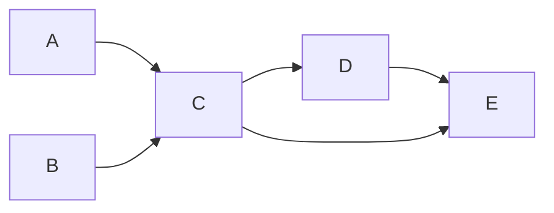

<!-- _class: lead -->

<!--
Can use:
- general provable security concepts
- encryption, one-time pads, key re-use
- malleability
- oracles, subroutines
- random sampling
- indistinguishability of distributions and games
- EdDSA
-->

# Formalizing the Security of Zcash

## Guest talk for the Applied Cryptography course<br/>at the American University of Beirut

**Daira-Emma Hopwood**<br/>
Zcash Open Development Lab

11th September, 2026

<!--
Speaker notes go in HTML comments like this one; the presenter view shows them.
-->

---

# Acknowledgements

The Ironwood formalization is a joint work between me (at
[Zcash Open Development Lab](https://zodl.com/about/)), Tal Derei (at
[Project Tachyon](https://tachyon.z.cash/team/)), and Gregor Mitscha‑Baude
(sponsored by Project Tachyon), with contributions from Giorgio Dell’Immagine,
Sean Bowe, Abhinav Vishnu, and Dev Ojha.

The inventors of Zerocash are Eli Ben‑Sasson, Alessandro Chiesa, Christina Garman,
Matthew Green, Ian Miers, Eran Tromer, and Madars Virza.

The designers of the Zcash protocol are the Zerocash inventors and also me, Sean Bowe,
Jack Grigg, Simon Liu, Taylor Hornby, Nathan Wilcox, Zooko Wilcox, Jay Graber,
Eirik Ogilvie‑Wigley, Ariel Gabizon, George Tankersley, Ying Tong Lai, Kris Nuttycombe,
Jack Gavigan, Steven Smith, and Greg Pfeil.

Many other contributors and influences are given in the Acknowledgements section of
the Zcash Protocol Specification.

---

# Summary of the talk

Not in this exact order:

- Background: Zcash, blockchains, commitment schemes, zero-knowledge proofs
- Security goals for private digital cash
- Griping about unreviewed security proofs
- How does Zcash work?
- Using Lean with AI
- Human understanding and explanation is everything
- The Ironwood formalization
- Conclusions

---

# What is Zcash, and why?

The world is turning into a surveillance dystopia, and part of that is financial
surveillance. Physical cash allows people to transact privately face-to-face.
Zcash aims to allow the same thing across a network.

This is personal for me because financial surveillance is used in a harshly
discrimatory way against people I care about — disabled people claiming benefits,
refugees and migrants, etc.

Financial privacy is deeply entwined with bodily autonomy, location privacy,
freedom of speech, freedom of association, and resistance to oppression.
You have no privacy without financial privacy.

---

# Protocol security analysis in general

A protocol aims to allow its users to interact and achieve their goals without
interference.

- What do users need from the protocol?
- How can adversaries interfere with what users need?

Adversaries include:
- eavesdroppers; man-in-the-middle attackers;
- protocol participants;
- authorities (governments, “trusted” entities);
- designers and implementors of the protocol / any subprotocol or algorithm it uses;
- providers of hardware, operating systems, etc.
- and anyone who can coerce or exploit any of the above.

---

# There is no silver bullet

All high-assurance cryptography techniques are just ways of finding flaws.

When you manually review a piece of code, check an algorithm against
test vectors, etc., you will find some subset of the possible flaws with
some likelihood. High-assurance techniques are just that but using different
methods, covering more code, for some hopefully larger set of attacks,
with a better likelihood of finding any flaws that are there. They don’t
provide a fundamentally different *kind* of assurance.

This implies that it’s misguided to try to use high-assurance techniques
*instead of* “conventional” techniques. On the contrary, you *need* to use
test vectors, etc. to gain confidence that your proof is about the same
thing you’ve implemented. That especially, but not only, applies when the
proof and the implementation are in different languages.

---

# “Security proofs”

Whenever you see something called a “security proof”, remember that:

- it might be wrong;
- it might be proving the wrong thing;
- it does not rule out attacks that break an assumption;
- it does not rule out attacks that fall outside the model;
- it will not help unless its limitations can be understood.

*All* of this also applies to machine-checked proofs — that is, proofs
written in a math-oriented programming language that a computer can verify.
A machine-checked proof is less likely to be outright wrong, but at least
as likely to be proving the wrong thing unless you’re exceptionally careful.

---

# Why do I like machine-checked proofs anyway?

Pen-and-paper proofs allow you to handwave. Those handwaves are usually
where the bugs are. A machine-checked proof is like a program
(constructive proofs are literally programs): it forces you to be precise.

I find that the best machine-checked proof results come from doing a
pen-and-paper proof first. This is how a lot of the Zcash formalization
was done.

An important piece of context is that machine-checked proofs are now much
more practical to write with the help of AI — even for complicated
protocols like Zcash. I have very mixed feelings about AI, and I’ll
get to that later in the talk, but it does help a lot here.

---

# Wrong proofs

Zcash is based on
[Zerocash: Decentralized Anonymous Payments from Bitcoin](http://zerocash-project.org/media/pdf/zerocash-extended-20140518.pdf), May 2014.
We reviewed it thoroughly and found these flaws — all corrected before Zcash’s launch:

- A commitment scheme with only 64 bits of security, implicitly assumed to be secure.
  This would have been a fatal balance flaw.
- Two PRFs implicitly assumed collision-resistant, which is not implied by standard security
  goals of a PRF. This was hidden by two other proof errors.
- Implicitly assuming a hash function remained collision-resistant after truncating a few bits
  of the output (it’s easy to construct counterexamples).
- Other latent problems with truncating values but using the original value in the proof.
- The Completeness definition uses a low-level property about “nullifiers” as a proxy for
  the intended property of being able to spend, without proving the former implied the latter.

<!--
The reason to truncate values was to fit into a single SHA-256 input block.
-->

---

# Wrong proofs (continued)

There were also latent problems with the security modelling; the adversary is not given
enough power (e.g. cannot do rollback attacks or front-run transactions). We knew about
these but were only able to correct them in my [presentation](https://www.youtube.com/watch?v=f6UToqiIdeY)
for the Zcon3 conference, ~6 years after launch.

There was another critical flaw in Zerocash that we didn’t spot:

- The setup procedure of the BCTV14 SNARK made a value public that it should not have,
  allowing an attack against soundness.

---

# Why is this hard?

The Zerocash authors were not unusually careless. The main reason it’s hard, in my view,
is that there’s too much to keep in your head.

Everyone knows there’s a systematic problem with proofs not getting adequate review.
Proofs are not inline because page limits prevent it, and reviewers are not usually
expected to read appendices. *Don’t assume that proofs are correct because they’re in
a published paper.*

Maybe this could change with AI? But it’s mostly a cultural problem, both in the
publication pipeline and with what is considered to be an adequate bar for deploying
protocols.

The errors on the last slide are fully documented in section 8 of the Zcash Protocol
Specification. There is no corrected version of the Zerocash paper.

---

# Timeline of Zcash and Ironwood

<!-- _class: small -->

| Date        | Event                                                          | Date        | Event |
|-------------|----------------------------------------------------------------|-------------|-------|
| 2015-2016   | Pre-launch development                                         | 2024-Nov-23 | NU6: Extend funding; create lockbox |
| 2016-Oct-28 | Zcash launch ($\mathsf{Sprout}$ using Groth16)                 | 2025-Nov-24 | NU6.1: Access funding from lockbox |
| 2018-Mar-01 | Ariel Gabizon finds the BCTV14 soundness vulnerability         | 2025-Mar    | Idea for Quantum Recoverability and ZIP 2005 |
| 2018-Mar    | [Sean Bowe rewrites the Sprout circuit for Groth16](https://github.com/zcash/sapling-crypto/pull/54) | 2026-Apr    | Quantum computers look closer; ZIP 2005 work is resumed |
| 2018-Jun-26 | NU0: Overwinter tests out hard-forking network upgrades.       | 2026-Apr    | AI starts working (contrary to my predictions) |
| 2018-Oct-29 | NU1: $\mathsf{Sapling}$ — BCTV14 soundness vulnerability fixed | 2026-Apr-May| The AI-pocalypse of security bugs — incredibly stressful and tiring |
| 2018-Nov-13 | Soundness vulnerability disclosed to Horizen & Komodo          | 2026-May    | ZIP 2005 pen-and-paper proofs rewritten using AI; handwaves fixed |
| 2019-Feb-05 | [Public disclosure of the soundness vulnerability](https://web.archive.org/web/20190601040712/https://electriccoin.co/blog/zcash-counterfeiting-vulnerability-successfully-remediated/)           | 2026-May-29 | Taylor Hornby finds the Orchard soundness bug |
| 2019-Dec-11 | NU2: Blossom — halved block times                              | 2026-Jun-02 | Orchard is turned off |
| 2020-Jul-16 | NU3: Heartwood — shielded coinbase, FlyClient support          | 2026-Jun-03 | NU6.2: Orchard is turned back on again with a fixed circuit |
| 2020-Nov-18 | NU4: Canopy — funding, deprecate Sprout, note enc. fix         | 2026-Jun-09 | Ironwood formalization effort starts |
| 2022-May-31 | NU5: $\mathsf{Orchard}$ activation — new shielded protocol     | 2026-Jul-28 | NU6.3: Ironwood activates; new pool Quantum Recoverable |
| 2022-Aug-09 | Zcon3 talk: security modelling; pen-and-paper proofs           | 2026-Jul-28 | Formalization announced “complete” (circuit only) |

---

# What properties does private digital cash need?

1. Users should be able to hold tokens of the currency, and transfer them to other
   users.
2. There is an (at least) eventually consistent, linearizable history of *transactions*
   that each balance individually.
3. Transactions should be authorized by the spender(s) and send funds to the right
   destination(s).
4. It must be impossible to create tokens other than by issuance mechanisms that
   are collectively agreed on.
5. Transactions should reveal as little as possible<sup>⚠️</sup> about transfers, and
   about users’ balances.

Transparent blockchain-based cryptocurrencies like Bitcoin achieve the first four of these
properties, but not the fifth.

---

# How does Zcash address this?

Zcash is a blockchain-based cryptocurrency. Its design and implementation were
originally forked from Bitcoin and Bitcoin Core. Cryptocurrencies are covered
later in the course, so I’ll go through a bit of the necessary background.

A central issue in cryptocurrency design is how to prevent double-spending. Unlike a
physical coin or banknote, there are no limitations on copying data. So we have to
impose the policy that only the first attempt to spend a note takes effect, and
subsequent attempts are rejected.

To do this we need participants to agree on the ordering of transactions that could
potentially double-spend.

<!--
Why the first attempt? It’s actually the only option, because when we see the
first one, we don’t know whether there will be others (and usually there won’t be).
-->

---

# Background: consensus in block chains

A block chain is a distributed data structure, replicated across nodes — all of
which might have a different view of it. Each block is chained to its parent,
referring to it by a collision-resistant hash. The block “chain” should more
precisely be considered a block tree, which includes all of the blocks that
participating nodes have seen.

The lowest layer of a blockchain protocol is sometimes called “L$0$”. The property
we want from this layer is that nodes that are sufficiently well connected to
each other<sup>⚠️</sup> all *agree* with high probability on the same chain prefix —
possibly excluding the last few blocks. This property is called *eventual consistency*.

---

# Background: consensus in block chains (continued)

If we just got nodes to vote on which chain should be followed, then an adversary
could win by pretending to be many nodes (called a “pseudospoofing attack”).
Practical block chain protocols have some way to make that attack expensive, for
example using “Proof-of-Work”. This mechanism doubles as a way to calibrate the
rate at which blocks are produced.

Zcash’s L$0$ is very similar to Bitcoin’s. We’ll be taking that for granted and
talking about the layer above that in which we build transactions that send money.

<!--
⚠️ If this strikes you as fuzzy and not as well defined as we would like, that’s
right. Actually it’s a bit tautological: you can make the property true by
excluding nodes that don’t agree with the others as “not well enough connected”.
But that isn’t the topic of this talk.
-->

---

# Background: TXO-based blockchains

Blocks contain transactions. In a TXO-based system, the transactions form a directed
graph, in which outputs are connected to the inputs that spend them.



The TXO model is not the only possibility: some blockchains, like Ethereum, are
“account-based”. But Zcash is TXO-based.

---

# Background: consensus rules

A *consensus rule* is a rule enforced by all nodes in a blockchain network.
They are called that because the consensus layer will only agree on a chain
that satisfies the consensus rules.

The primary way that blockchains like Zcash upgrade functionality or fix security
problems is to get “all” nodes to agree to a change in the consensus rules.

The significance for security analysis is that we can reasonably take the
consensus rules as assumptions (this obviously depends on them being correctly
implemented).

---

# Background: commitments

Now we’re going to describe some lower-level abstractions.

A *hiding commitment* is a short string that commits to a value: it conceals
the value (hiding) and makes it difficult to find two different values with the
same commitment (binding).

A deterministic commitment could not be hiding, because an adversary could
guess the input. So, the creator of a hiding commitment computes it using
randomness, and then later can “open” the commitment by revealing the input
and randomness.

Commitments are a very useful and fundamental cryptographic construct, and
Zcash uses them in many places. For example, it uses them to commit to *notes*
to allow proving that they were outputs of a previous transaction, and also to
commit to the values that are spent and created in a transaction.

---

# Background: Pedersen commitments

*Pedersen commitments* are a kind of group-based commitment:

$$
\mathsf{cv} = \mathsf{v} \cdot \mathcal{V} + \mathsf{rcv} \cdot \mathcal{R}
$$

with the useful property of being *additively homomorphic*: if you add two
commitments to $\mathsf{v}_1$ and $\mathsf{v}_2$ as group elements, you get a
commitment to $\mathsf{v}_1 + \mathsf{v}_2$ added as scalars. So this lets you
add up committed values while still keeping them hidden.

This scheme is *perfectly hiding*: if the randomness $\mathsf{rcv}$ is chosen
uniformly on the scalar field, then $\mathsf{rcv} \cdot \mathcal{R}$ is uniform
on the group, and so it is like a one-time-pad encrypting $\mathsf{v} \cdot \mathcal{V}$
(with the same requirement of a fresh $\mathsf{rcv}$ for each use).

It is *binding* iff the Discrete Logarithm Relation problem is hard in the group.

---

# Background: discrete logarithm relations

Suppose we have a cryptographic group $G$, written additively with identity $\mathcal{O}$,
and a list of $n$ distinct non-identity elements of $G$, called a *basis*: $B_0, \ldots, B_{n-1}$.

A *nontrivial discrete logarithm relation (DLR)* over $B$ is a list of $n$ scalars
$x_0, \ldots, x_{n-1}$ where

$\hspace{9em}\displaystyle \sum_{i=0}^{n-1}\, [x_i]\, B_i = \mathcal{O}\quad$ and the $x_i$ are not all zero.

If the elements of $B$ are chosen randomly, then this problem is exactly as hard as the usual
Discrete Log Problem. Heuristically, we also expect this to be true if some or all of them are
chosen via a suitable hash into the group. Using a suitable hash matters because it prevents
a backdoor similar to that of Dual_EC_DRBG.

Note that, even with a well chosen basis, the adversary can get to work on computing a
discrete logarithm as soon as they see that basis.

---

# Background: <strike>actual magic</strike> Arguments of knowledge

- Relation: a mathematical statement of type
  $\mathsf{instance} \times \mathsf{witness} \rightarrow \mathsf{bool}$.
- Argument: protocol in which a prover tries to convince a verifier of
  something about a relation, with computational security.
- of Knowledge: the “something” is that the prover *knows* some witness for a
  given instance of the relation.

We’ll have more to say later about how knowledge is modelled, and about
how the relations are expressed in practice.

How common usage differs: people don’t say “argument”, they say “proof”.

---

# SNARKs

A SNARK is a Succinct Noninteractive Argument of Knowledge:

- Noninteractive: the argument is just a string that the prover gives the
  verifier.
- Succinct:
  - that string is short, even when the statement is large, and/or
  - the verifier has to do little work to check it, even when the statement
    is large.

Usually, “succinct” means that the proof size and the verifier’s work are
both at most logarithmic in the statement complexity, and concretely small.

Aside: I still find these things magic after 11 years of working with them.

---

# zk-SNARKS

A zk-SNARK is a SNARK that is also “zero-knowledge”. This has a technical
definition, but informally it means that the proof reveals *only* the fact
that the prover knows a witness.

In common usage, “zero-knowledge proof” usually refers to a zk-SNARK.

You may hear “zk proofs” informally for argument systems that are not zero-knowledge.
This is wrong and misleading, but be aware of the wrong usage (and don’t propagate it).

---

# How do SNARKs work? (handwavy)

The magic in SNARKs really comes from:
1. expressing the statement we want to prove in terms of polynomials,
   which will all be zero if the statement holds;
2. using linear combinations with random challenges to fold those
   polynomials together;
3. having the prover demonstrate that:
   a) the folded polynomial has small degree;
   b) evaluating it at a random point gives zero.

This depends on a fact about polynomials called the Schwartz–Zippel
lemma. Roughly speaking: if a polynomial of small degree over a large
integral domain (such as a finite field) evaluates to zero at a random
point, then it likely evaluates to zero at every point.

---

# Why is it complicated to write correct circuits?

In order to take advantage of the magic of polynomial zero-testing,
the statement has to be expressed as a set of polynomial equations,
of limited degree, over a finite field.

An “arithmetization” is a language that constrains which equations
you can use. It may also support features like lookups (which can
compile down to polynomials). There are three main families of
arithmetization used in practice: R1CS, Plonkish, and AIR.

None of them are particularly natural programming languages:
- It's hard to express conditionals.
- We can't directly express loops, we have to expand them
  to their maximum number of iterations.
- To express any type that is not the exact finite field our
  polynomials are defined over, we may need many range checks.

---

# Another approach: virtual machines

Another possible approach is to use a virtual machine, but this is
an abstraction on top of a circuit-based system.

If you have few statements, this doesn't help: it just moves the
assurance task to the circuit(s) that implement the VM. It might pay
off if we have lots of different statements, but it also introduces
a lot of overhead.

I'm personally not a big fan of virtual machines for SNARKs: I think
they're very complicated and likely have soundness bugs. The assurance
budget is better spent on compilers to circuits, which would avoid
the overhead.

---

# Proof systems used in Zcash

Zcash has had three *shielded protocols*: $\mathsf{Sprout}$, $\mathsf{Sapling}$,
and $\mathsf{Orchard}$.

It uses hand-optimized circuits directly:

- $\mathsf{Sprout}$ and $\mathsf{Sprout}$ use Groth16 with R1CS
  circuits, which only support quadratic constraints:
  $(\mathit{lincomb}) × (\mathit{lincomb}) = (\mathit{lincomb})$
- $\mathsf{Orchard}$/$\mathsf{Ironwood}$ use Halo 2 with Plonkish
  circuits, which support more general “custom gates” (each is a
  polynomial up to a degree bound), lookups, and “copy constraints”.
  
When you have at most three circuits for a given arithmetization,
this is the approach that makes most sense. But it meant we had to
hand-optimize the circuits.

---

# A perfact application for formal verification

We have:

- a complicated programming task;
- a lot of money riding on correctness;
- a well defined set of targets that need to be correct;
- a team with a strong computer science, math, and functional
  programming background with long-standing interest in FV.

This is a perfect application for formal verification. But in 2016,
2018, and 2020 when we were designing the circuits, it was just not
practical: we didn't have enough time.

---

# Some context: two balance bugs in Zcash

- The proof system originally used for $\mathsf{Sprout}$, called BCTV14,
  relied on a “trusted setup”. The MPC protocol used to perform the setup revealed
  too much information in its transcript, which could have allowed proofs
  to be forged using that information.
- The original $\mathsf{Orchard}$ circuit had a soundness flaw: one of the
  elliptic curve points was not properly connected to the input. This was fixed
  in the emergency NU6.2 upgrade (June 2026).

Both of these flaws could have allowed counterfeiting: creating Zcash tokens
from thin air. There's no evidence that any counterfeiting actually occurred.

---

# Timeline of Zcash and Ironwood (again)

<!-- _class: small -->

| Date        | Event                                                          | Date        | Event |
|-------------|----------------------------------------------------------------|-------------|-------|
| 2015-2016   | Pre-launch development                                         | 2024-Nov-23 | NU6: Extend funding; create lockbox |
| 2016-Oct-28 | Zcash launch ($\mathsf{Sprout}$ using Groth16)                 | 2025-Nov-24 | NU6.1: Access funding from lockbox |
| 2018-Mar-01 | Ariel Gabizon finds the BCTV14 soundness vulnerability         | 2025-Mar    | Idea for Quantum Recoverability and ZIP 2005 |
| 2018-Mar    | [Sean Bowe rewrites the Sprout circuit for Groth16](https://github.com/zcash/sapling-crypto/pull/54) | 2026-Apr    | Quantum computers look closer; ZIP 2005 work is resumed |
| 2018-Jun-26 | NU0: Overwinter tests out hard-forking network upgrades.       | 2026-Apr    | AI starts working (contrary to my predictions) |
| 2018-Oct-29 | NU1: $\mathsf{Sapling}$ — BCTV14 soundness vulnerability fixed | 2026-Apr-May| The AI-pocalypse of security bugs — incredibly stressful and tiring |
| 2018-Nov-13 | Soundness vulnerability disclosed to Horizen & Komodo          | 2026-May    | ZIP 2005 pen-and-paper proofs rewritten using AI; handwaves fixed |
| 2019-Feb-05 | [Public disclosure of the soundness vulnerability](https://web.archive.org/web/20190601040712/https://electriccoin.co/blog/zcash-counterfeiting-vulnerability-successfully-remediated/)           | 2026-May-29 | Taylor Hornby finds the Orchard soundness bug |
| 2019-Dec-11 | NU2: Blossom — halved block times                              | 2026-Jun-02 | Orchard is turned off |
| 2020-Jul-16 | NU3: Heartwood — shielded coinbase, FlyClient support          | 2026-Jun-03 | NU6.2: Orchard is turned back on again with a fixed circuit |
| 2020-Nov-18 | NU4: Canopy — funding, deprecate Sprout, note enc. fix         | 2026-Jun-09 | Ironwood formalization effort starts |
| 2022-May-31 | NU5: $\mathsf{Orchard}$ activation — new shielded protocol     | 2026-Jul-28 | NU6.3: Ironwood activates; new pool Quantum Recoverable |
| 2022-Aug-09 | Zcon3 talk: security modelling; pen-and-paper proofs           | 2026-Jul-28 | Formalization announced “complete” (circuit only) |

---

# Zcash concepts: pools

All value in Zcash resides in a *pool*. There are six pools:

- a *transparent pool* using a protocol that works like Bitcoin;
- shielded pools for each of the $\mathsf{Sprout}$ and $\mathsf{Sapling}$ protocols;
- two pools (*Orchard* and *Ironwood*) for the $\mathsf{Orchard}$ protocol;
- a “lockbox” used to fund development (also transparent).

Whenever a transaction moves value between pools, those amounts are visible,
so there is public accounting of the total balance of each pool.

---

# Zcash concepts: notes

Shielded value is held in *notes*.

A note is sent to an *address*. It has a *commitment* and a *nullifier*.
When a note is created in a shielded pool, its commitment is added to a
Merkle tree for that pool. When it is spent, its nullifier is added to a
*nullifier set* for the pool.

To prevent double-spending, a note’s nullifier cannot appear twice on the
chain.

---

# Zcash concepts: sender anonymity

Design decision: transfers are sender-anonymous at the shielded protocol layer.
That is, that layer does not directly tell the intended recipient anything about
who sent the funds.

This doesn’t mean that other information can’t be inferred from context. The
recipient may only have given out the *address* to one person, for example.

If we aim for the protocol to preserve strong anonymity, we can always
*selectively* weaken it by providing keys that give access to additional
information. If the base protocol reveals information by default, we cannot
unreveal it.

---

# The role of necessary security properties

The next few slides will mention some properties that are *necessary, but not sufficient*
for Zcash to be secure. It would be easy to dismiss these as not being relevant to formal
security analysis because it would be a mistake to *conclude* security from them.

In practice, though, work spent on analysing such properties can save a lot of time:
- You only want to expend formalization effort on a protocol that is close
  to being secure. It might need repair, but it shouldn’t need wholesale redesign.
- They’re needed to understand the motivation behind the protocol’s design.
- They might turn up as intermediate statements that you need to prove along the way.
- The strength of results you’re able to prove will often depend on having
  optimized these necessary properties.

---

# Privacy for commitments and nullifiers

Remember that transaction *outputs* reveal commitments, and transaction
*inputs* (spends) reveal nullifiers.

For privacy, we want (necessary, not sufficient) that:

- Neither the commitment nor nullifier reveal the note’s value or identity.
- A note’s commitment and nullifier must be *unlinkable*. Otherwise, we would
  be able to tell when a given output is spent, exposing information about the
  transaction graph that we want to keep private.

---

# Balance for commitments and nullifiers

For Balance, we want (necessary, not sufficient) that:

- A committed note cannot have *more than one* nullifier. If it did, then it
  could be spent more than once.
- At any point in time, the spent notes (that have nullifiers in the
  nullifier set) should be a subset of the notes ever created (that have
  commitments in the Merkle tree).

The latter is an example of an important property that we’ll have to prove
along the way. We’ll call it “Balance subset”.

---

# Spendability

Spendability means, informally, that if a user submits a correct transaction
that tries to spend their notes, and that transaction is logged to the chain
without the notes being double-spent by a holder of their spending key(s), then the
notes will be spent as intended.

For Spendability, we want (necessary, not sufficient) that:

- Spending a note is correctly authorized (Spend authority).
- Two different notes cannot have the *same* nullifier. If they did, then it
  wouldn’t be possible to spend both of them (a “Faerie Gold attack”).
- If an adversary without the spending key(s) sees your transaction
  before it is permanently logged in the chain, it can’t submit its own
  transaction that makes yours invalid (a “roadblock attack”).

---

# How does Zcash work? (continued)

- Spending a note requires proving in zero knowledge that you *know*:
  - the note being spent;
  - the spending key for the note’s address;
  - a Merkle path showing that its commitment was in the note commitment tree
    before a given *anchor* (Merkle tree root);
- and are revealing the correct nullifier for that note.

In fact we don't directly use the spending key, we make a randomized
signature showing that we know it. This is more efficient for hardware
wallets, which currently can make signatures but not proofs.

---

# Separation of proof system and statement

The fix for the BCTV14 vulnerability demonstrates an important point:
the statement we are proving is separate from the proof system used to
prove it.

They are not entirely independent: typical proof systems require a specific
choice of finite field (often a prime field of around ~256 bits). This does
not change what is *possible* to express, but it affects what can be expressed
*efficiently*.

---

# Informally, what does security rely on?

- For privacy: the commitments and nullifiers have to be unlinkable.
- For balance: each transaction has to balance, we have to be spending
  only real notes, and each of them can only be spent at most once.
- For spendability: we have to be able to spend each note once; that
  requires that each has a distinct nullifier.
- For spend authority: we have to be checking the spender's knowledge
  of the right private key.

These are necessary but not sufficient. For a security argument, we need to:

- Define the goals rigorously.
- Give *security reductions*.

---

# What is a security reduction?

A reduction is an *efficiently computable algorithm*, that converts (“reduces”)
an adversary (in a given model) that breaks the security property, to an adversary
that breaks the target problem(s).

This is not quite the same as “assuming that the target problem is hard, we
cannot break the security property”. Why not?

<!--
Hints:
- “In a given model”
- What do we mean by “hard”?
- How does it depend on the adversary?
- How does it depend on the computation model?
-->

---

# Why not “assume the target problem is hard”?

In a protocol that depends on fixed problems (discrete logs, hash collisions,
etc.), *there exist* adversaries that hard-code the answer to the problem.
Zcash is such a protocol because it depends on discrete-log commitment schemes
with fixed bases.

If we know the discrete log of $\mathcal{V}$ with respect to $\mathcal{R}$, then
we can open any value commitment to an arbitrary $v$. The Halo 2 SNARK also uses
fixed bases.

Trying to exclude those adversaries doesn’t work. There also exist adversaries
that hard-code the result of a massive precomputation that solves the difficult
part of the problem.

--- 

# Dealing with hard-coded adversaries

There are three ways to get around this, all of which are used in practice in
the cryptographic literature (sometimes in combination):

1. Express the protocol in terms of a parameter $\lambda$, and only argue security
   asymptotically, for *uniform* adversaries. A uniform adversary has to be able
   to solve the target problem for arbitrarily large $\lambda$, so hard-coding
   answers for a particular $\lambda$ doesn’t help it.
2. Express the protocol in terms of randomized parameters, and argue that if
   an adversary has very low probability of breaking the protocol over random
   choices of those parameters, then we have ruled out attacks that do not depend
   on the specific deployed choices.
3. Accept hard-coding and massive precomputation as valid breaks, and leave the
   question of whether anyone *knows* such break information outside the analysis.
   This is Rogaway’s “[Formalizing Human Ignorance](https://eprint.iacr.org/2006/281)” approach.

---

# Dealing with hard-coded adversaries (continued)

My opinion is that purely asymptotic analysis is insufficient for real-world
protocols, which aren’t defined for an arbitrary security parameter.

Even if they were, what we care about is a deployment at a fixed size, or fixed
maximum size.

The Ironwood formalization uses a combination of 2 (express the protocol in terms
of randomized parameters) and 3 (the “Formalizing Human Ignorance” approach).
But mainly 3.

---

# Soundness vs knowledge soundness

Remember that an *argument* is a computational proof of a *relation*.
The relation has public input variables (the *instance*), and internal variables
(the *witness*).

An argument system is:

- *sound*, if it’s not possible to find a proof that verifies when no witness exists.
- *knowledge sound*, if it’s not possible to find a proof without knowing a witness
  (i.e. you have to use the witness to make the proof).

---

# Modelling knowledge (zk case)

We want to construct security reductions for protocols using arguments of knowledge.

The intuition for how to do that is that whenever the reduction sees a proof $\pi$
for relation $\mathcal{R}$ that verifies against an instance $x$ (i.e.
$\mathsf{SNARK.Verify}_{\mathcal{R}}(x, \pi)$ is true), it can assume that except
with small probability, the adversary must provide it with *either*:

- a witness for that instance ($w$ such that $\mathcal{R}(x, w)$); or
- evidence that some valid proof for the same instance was seen before.

The latter case covers replaying proofs, and malleability (modifying a proof so
that it is still valid for the same instance, but is a different proof string).

Because we’re in the zk case, we can infer that a proof for a given instance
doesn’t give any information about witnesses for other instances. So
we don’t need to be worried about the possibility that proofs could be malleated
or combined to give a proof for another instance.

---

# Modelling knowledge (non-zk case)

If we’re using a non-zk proof system, we presumably don’t care that proofs leak
information about the witnesses. But if we think back to the motivations for
caring about *knowledge* soundness, they are all examples that involve proving
knowledge of keys or some other authorizing information — and so it’s hard to
see why we wouldn’t want zk for those.

There are two situations where this can be useful, though:

- proving knowledge of the witness only matters once.
- recursive proofs.

---

# Modelling knowledge (recursive case)

An important case where non-zk knowledge soundness comes up is in recursive
proofs. Halo 2 was originally designed to support recursive proofs, but we
never found time to implement that. They will be used in an upcoming shielded
protocol, Tachyon.

All of the proofs in a recursion tree need to be knowledge-sound. Here’s why:
if we have a recursive *argument* system, i.e. (only) computationally sound,
then there will *exist* proofs that verify but have no satisfying witness, i.e.
proofs for false statements. And we may be able to prove that they exist.

And so when we prove *only soundly* that the verifier accepts a proof, it might
be a false proof, making the recursive proof vacuous. If on the other hand
we prove *knowledge-soundly* that the verifier accepts a proof, then the
extractor has to exhibit it, and we can argue that this is as good as actually
running the verifier on it<sup>⚠️</sup>.

---


# Balance integrity

Let’s define our security goal more precisely. In Zcash we have six
value pools. But we will simplify the problem to consider only two: a
transparent pool, and a shielded pool (Orchard or Ironwood).

Notice that we will miss attacks that inherently involve multiple shielded pools.
Actually since Orchard and Ironwood share key material, it’s plausible that there
might be attacks that require access to both pools. I intend to extend the model to
cover that, but it’s not done yet.

(There are no current plans to cover Sprout or Sapling: those use a different proving
system and three other circuits, and it’s less likely that there could be cross-protocol
attacks between them and Orchard/Ironwood because they don’t share key material, other
than the overall wallet seed. How far to simplify is often a judgement call, based on
available resources and how likely we think it is that we could miss an attack that
falls outside the model.)

---

# Balance integrity (continued)

In the model, we have a transparent pool and a shielded pool. The protocol
can account publically for the total value in the transparent pool, and
the amounts transferred between pools, so can check in consensus that the value
in the *transparent* pool does not go negative.

An adversary’s advantage against Balance integrity is the probability that they
can find a consensus-valid ledger that violates the following goals:

- the value in the *shielded* pool is non-negative; and
- the sum of the value in the transparent and shielded pools is exactly equal to
  the total amount ever issued.

In practice, we can destroy value by sending it to an address for which no-one
knows the key, or by failing to encrypt it correctly to the recipient. The model
still considers that value to exist, which is why the second point is an exact equality.

---

# Structure of balance properties

```mermaid
%%{init: {"flowchart": {"nodeSpacing": 30, "rankSpacing": 40, "padding": 8, "diagramPadding": 4}, "themeCSS": "marker { overflow: visible !important; } marker path { transform-box: fill-box !important; transform-origin: center !important; transform: scale(1.25) !important; }"}}%%
flowchart LR
  BAL["Balance integrity"]

  BAL --> BS["Binding-signature<br/>balance"]
  BAL --> NCB["Note-commitment<br/>binding"]
  BAL --> MERK["Merkle-path<br/>binding"]
  BAL --> KB["Key<br/>binding"]

  DL{{"<span style='display:block; height:0.5em'></span>Discrete log<span style='display:block; height:0.5em'></span>"}}

  BS --->|"<a target='_blank' href='https://github.com/zcash/ironwood/blob/main/Zcash/Security/BindingSignature/Balance.lean'>non-balancing<br/>bundle computes</a>"| CDLR{{"<span style='display:block; height:0.5em'></span>Nontrivial discrete-log<br/>relation, combined<br/>deployed basis (Pallas)<span style='display:block; height:0.5em'></span>"}}
  BS --->|"<a target='_blank' href='https://github.com/zcash/ironwood/blob/main/Zcash/Security/Ledger/ExtractionArm.lean'>verifying signature<br/>the extractor misses</a>"| KERR["RedDSA<br/>extractability"]
  BS --> STMT["Witness or replay<br/>evidence<br/>ActionSatisfied"]
  NCB --->|"<a target='_blank' href='https://github.com/zcash/ironwood/blob/main/Zcash/Security/Ledger/Statement.lean'>wrong note<br/>opening computes</a>"| NCBK["NoteCommitBreak"]
  NCB --> STMT
  MERK --> STMT
  MERK --->|"<a target='_blank' href='https://github.com/zcash/ironwood/blob/main/Zcash/Security/Ledger/Merkle.lean'>wrong Merkle<br/>path computes</a>"| MC["DefinedCollision<br/>one height,<br/>encoding domain"]
  KB --> STMT
  KB --->|"<a target='_blank' href='https://github.com/zcash/ironwood/blob/main/Zcash/Security/Ledger/KeyBindingDLR.lean'>Orchard-protocol<br/>CommitIvkCollision<br/>computes</a>"| CDLR

  STMT STMTtoKS@-->|"<a target='_blank' href='https://github.com/zcash/ironwood/blob/main/Zcash/Security/Ledger/OrchardExtractionExperiment.lean'>Extract witness-<br/>annotated chain</a>"| KS["Knowledge soundness:<br/>accepting proof yields<br/>witness or break data"]
  NCBK --> CDLR

  KERR KERRtoCDLR@==>|"<a target='_blank' href='https://github.com/zcash/ironwood/blob/main/Zcash/Security/RedDSA/Extraction.lean'>good challenge<br/>computes</a>"| CDLR
  CDLR -->|"<a target='_blank' href='https://github.com/zcash/ironwood/blob/main/Zcash/Security/BindingSignature/DiscreteLog.lean'>independent<br/>Pallas bases</a>"| DL
  KS KStoDL@===>|"<a target='_blank' href='https://github.com/zcash/ironwood/blob/main/Zcash/Snark/Soundness/Action/AdaptiveStatementKnowledge.lean'>independent<br/>Vesta bases</a>"| DL
  MC --> CDLR

  click BAL "https://github.com/zcash/ironwood/blob/main/Zcash/Security/Ledger/Balance.lean" _blank
  click BS "https://github.com/zcash/ironwood/blob/main/Zcash/Security/BindingSignature/Balance.lean" _blank
  click NCB "https://github.com/zcash/ironwood/blob/main/Zcash/Security/Ledger/Statement.lean" _blank
  click MERK "https://github.com/zcash/ironwood/blob/main/Zcash/Security/Ledger/Merkle.lean" _blank
  click KB "https://github.com/zcash/ironwood/blob/main/Zcash/Security/KeyBinding/Basic.lean" _blank
  click STMT "https://github.com/zcash/ironwood/blob/main/Zcash/Security/Ledger/Statement.lean" _blank
  click NCBK "https://github.com/zcash/ironwood/blob/main/Zcash/Security/Ledger/Statement.lean" _blank
  click MC "https://github.com/zcash/ironwood/blob/main/Zcash/Security/Ledger/Merkle.lean" _blank
  click CDLR "https://github.com/zcash/ironwood/blob/main/Zcash/Security/Ledger/SinsemillaDLR.lean" _blank
  click KS "https://github.com/zcash/ironwood/blob/main/Zcash/Snark/Soundness/Relation/KnowledgeSoundness.lean" _blank
  click DL "https://github.com/zcash/ironwood/blob/main/Zcash/Common/DiscreteLogRelation.lean" _blank
  click KERR "https://github.com/zcash/ironwood/blob/main/Zcash/Security/Ledger/ExtractionKnowledgeError.lean" _blank

  classDef checked fill:#e8e8ff,stroke:#101060,color:#000000
  classDef assumed fill:#57606a,stroke:#424a53,color:#ffffff
  class BAL,NCB,BS,KB,MERK,STMT,CDLR,NCBK,MC,KERR,KS checked
  class DL assumed
  classDef agmEdge stroke:#8858c8,stroke-width:4.2px
  class KERRtoCDLR,KStoDL,STMTtoKS agmEdge
```



---

# What a transaction looks like

In the Orchard shielded protocol, a transaction has a list of “actions”, each of
which spends an input note and creates an output note. Either of these can be
“dummy” notes with zero value.

The abstract fields relevant to the Balance integrity argument are:

- $\mathsf{vBalance}$: a signed 64-bit value giving the net flow from the transparent
  to the shielded pool
- list of ``ActionDescription``s, each containing:
  - $\mathsf{cv^{net}}$: a Pedersen commitment to the output - input value of this action
  - $\mathsf{nf}$: the nullifier of the input note
  - $\mathsf{cm}_x$: the (short) commitment of the output note
- $\mathsf{proofOrchard}$: a Halo 2 proof covering all of the actions.
- $\mathsf{bindingSig}$: explained on the next slide.

---

# Binding signature

The simplest way to check that the value commitments balance (a *necessary*, not
sufficient, condition for the transaction to balance) would be to require the
transaction creator to “open” the sum of commitments to $\mathsf{vBalance}$.
It could do that by revealing the sum of random values $\sum \mathsf{rcv}$.

What Zcash actually does is more complicated, using a “binding signature” that
will verify only if the value commitments balance. It does this because it has
another goal: to prevent the actions from being transplanted into another transaction,
by proving that the creator of each action must have known its randomness. This
mainly matters when several parties are creating a transaction collaboratively.

---

# Treating the proof system as a black box

Goals that combine honest parties and integrity, like Spendability or
Spend authority, are inherently more complicated to analyse. That is why
we don’t yet claim a proof for those goals.

The property we want from a proof system is that it is possible to
replace it with a requirement that the adversary either provides a witness,
or replays a proof for an *instance* that they previously saw.
A replay does not have to be an identical proof.

We can use that to construct an *annotated ledger* that replaces proofs
with their witnesses. This is what makes the overall formalization
modular: the proofs of higher-level properties can treat the proof system
as a black box.

---

# Lean, and Propositions as Types

Lean is a programming language that also allows you to write proofs. It
uses an approach to theorem proving that we’ll call “propositions as some types”.
You may also hear it called the
[Curry–Howard correspondence](https://en.wikipedia.org/wiki/Curry%E2%80%93Howard_correspondence)
(or isomorphism).

| Proposition           | Type        | Term                           |
|-----------------------|-------------|--------------------------------|
| $A$ and $B$           | tuple       | $(a, b)$                       |
| $A$ or $B$            | enumeration | alternative $A$ or $B$         |
| $A \implies B$        | function    | def $f (a : A) : B := \ldots$  |
| $\exists x : X, p x$  | existential | $\langle e, \pi_{p e} \rangle$ |

---

# Computability in Lean

Lean’s type system, as for mathematics in general, can express functions
that are not computable. For example, we can write code that reasons about
arbitrary real numbers, or that proves that a value exists without saying
how to compute it.

The framework for expressing SNARK circuits that we were using is called
Clean. The initial version of the circuit written by Gregor proved *soundness*
—i.e. that a witness *exists*— rather than knowledge soundness (or
weak simulation extractability) which is what we need to fit the circuit
proof into the rest of the argument.

Even though we identified this issue quite early, the AIs we were using
kept on writing noncomputable code (I think because that was more heavily
represented in their current training data). This has only just been resolved.

---

# Lean

The great thing about doing security proofs in Lean is that there’s almost
no limit on expressiveness.

Also:

The terrible thing about doing security proofs in Lean is that there’s almost
no limit on expressiveness.

Using Lean for formal verification of cryptographic systems is using it a
little outside its present comfort envelope. Some design decisions are
not ideal for this area. But that can be worked around.

---

# Never apologize ;-)

Lean has a `sorry` construct used to mark a proof that is not done yet.

In the Ironwood effort we had a “no `sorry`s” policy, which early on we
started enforcing by CI for every PR.

It’s not *a priori* obvious that this is the right policy. It enforces
a style in which the development is built mostly bottom-up, and any
exceptions for things that haven’t been proven yet are written as
explict hypotheses. The main advantage of this when working with heavy
AI assistance is to force the AI not to take short-cuts.

You may find that this doesn’t work for you, but it worked well for us
and turned out not to be a significant limitation.

---

# Axiom checking

You can easily get the Lean compiler to complain about use of `sorry`, with
the `--wfail` option. But there are also other “escape hatches” —intended
to be used in defensible ways within the Lean standard libraries—
accessible to user code. Humans likely wouldn’t use these (or even know
about them), but it’s difficult to ensure that an AI wouldn’t use them as
a “short cut” without exhaustive review.

In [CompElliptic](https://github.com/daira/CompElliptic) and
[ironwood](https://github.com/zcash/ironwood) we use two macros to enforce
that definitions only depend on declared axioms:

- ``assert_axioms``, for general definitions;
- ``assert_computable``, which also enforces computability.

---

# My contribution to Wadler’s Law

Suggestion — use this formatting for Lean definitions:

```
def|theorem name (types)
    (hypotheses)
  :
    conclusion
  := [by]
    proof
```

I wish we’d used this (we might still change to it), because it makes the
separation between hypotheses, conclusion, and proof much clearer.

---

# Training

A lot of people use AI for vibe-coding. Its training data is biased
toward that. A good thing about using it for Lean is that the training
data it has for Lean is totally biased in the direction we want:

- careful early adopters;
- maintainers of Mathlib and Lean itself.

That means we have a fantastic training set right now, and I think that
was partly responsible for the success of Zcash's formalization effort.

---

# Practical *near-term* advice about using AI

I used Claude Opus 4.8 for most of the development and switched to Fable 5
when it became available. Tal used Codex.

- For difficult work, use the best model you can afford / have available to
  you, set to “xhigh” effort or similar. This burns tokens like crazy,
  and the centralization is awful both politically and for availability, but
  less capable models make too many mistakes for now.
- Current models forget practically everything at the compaction when you
  run out of context window. Any standing principles you want it to follow,
  you have to explicitly tell it to re-read. The loss of competence at the
  start of a session was brutal. Later in the development I hit
  on a set of memories that didn’t take up too much context but were enough
  to bootstrap it up to a reasonable level of competence.
- What also helped was to make it keep a log of what it did and planned to
  do, and regularly update it, especially when low on context. You don’t
  really even have to read this yourself.

---

# Claude-specific tips

- Turn on “thinking summaries”: add `"showThinkingSummaries": true` to `~/.claude/settings.json`.
- Leave effort on “xhigh” if you can afford it.
- If you use Fable, you might occasionally be dropped down to Opus by
  “cybersecurity protection” restrictions. It’s annoying (and Claude will
  agree with you that it’s annoying), but just bump it back up to Fable when
  you’ve finished the immediate thing that triggered the restriction.

---

# Lean is awesome and AI is alarmingly good at it

Nevertheless, Lean was the right tool for this job, because we needed to
prove some complicated things.

For example, in order to argue that outputs of the group hash can be used
as bases for the Discrete Logarithm Relation Problem without introducing any
weakness, we had to prove indifferentiability of that hash from a random
oracle. This required algebraic geometry results about genus 6 hyperelliptic
curves. The proof had to be left partly pen-and-paper because some of the
required concepts are not yet included in Lean’s Mathlib (there’s a project
to add them).

This wasn’t just Claude going off on its own and proving things about math
I didn’t initially know; it felt more collaborative than that. It was my
experience applying optimization techniques that let it get through the
hard parts.

---

# Human understanding and explanation is everything

AI is also, currently, alarmingly bad at understanding high-level goals.

Repeatedly I had the experience of Claude (Opus 4.8 and Fable on xhigh effort)
stopping short of what I’d asked it to do — despite having a memory that I’d
point to each time saying “push through to the deployed artifact”. I would
tell it that this is a principle it should continue to follow persistently,
but it would still always stop short.
Multiple times I thought it had got the point, but it never really did.

I honestly don’t know what direction this will go in. It could be that AIs
will for the foreseeable future very often subtly miss the point (when they
doesn’t do so unsubtly). Or this may be more fixable than it looks.

---

# Working on difficult problems with AI

Either way, the AI-bros and marketers for their companies seem to me to be
utterly divorced from the experience of trying to use AI to help work on
difficult problems.

I could not have got anywhere with this without understanding
the problem myself. It’s a problem that I’ve thinking about for 11 years
(and more, for cryptography in general), which no doubt helped, but I don’t
want that to discourage you. I’ve always maintained that becoming an expert
in something does not take that long; it takes about 3-4 years of focused
effort. You can get there.

---

<!-- _class: lead -->

# Questions?

<br/>

Ironwood book: https://zcash.github.io/ironwood

Ironwood repository: https://github.com/zcash/ironwood

CompElliptic repository: https://github.com/daira/CompElliptic

Understanding the Security of Zcash slides: https://github.com/daira/zcash-security

Protocol specification: https://zips.z.cash/protocol/protocol.pdf
